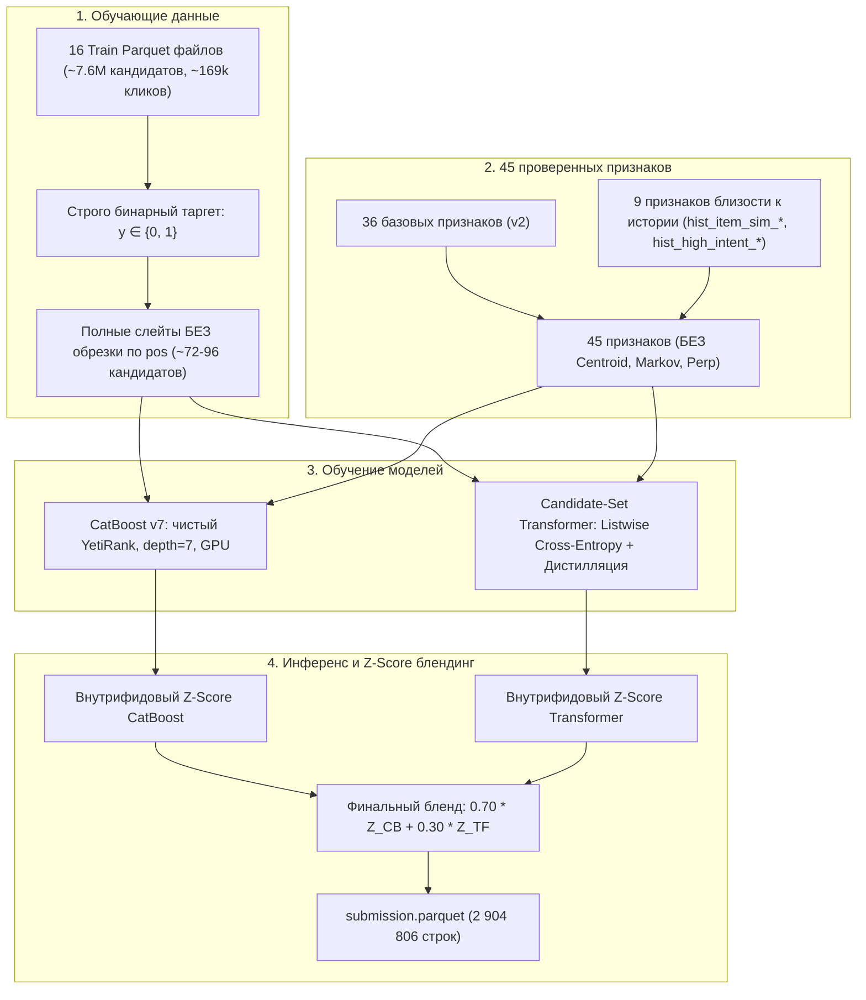

# Avito ML Cup 2026: Персональное ранжирование рекомендательной ленты

Репозиторий команды для соревнования **Avito ML Cup 2026: Персональное ранжирование** (ODS.ai).

Целевая метрика соревнования: **Full NDCG** (`NDCG:type=Base`) по всей длине рекомендательной ленты без усечения.

---

## 1. Результаты на Leaderboard и валидации

| Версия решения | Архитектурные особенности | Val Full NDCG | Public LB Full NDCG | Статус / Вывод |
|---|---|---|---|---|
| **v1 Baseline** | 9 базовых признаков, depth=6, 1 файл, чистый YetiRank | 0.349369 | 0.349369 | Базовая точка отсчета |
| **v2 Improved** | 36 признаков (+агрегаты, сдвиги от среднего), depth=7, 4 файла | 0.352971 | 0.352971 | +0.00360 стабильный прирост |
| **v4 Phase v1** | **45 признаков (`hist_item_sim_*`), чистый YetiRank, Z-Score 0.725 / 0.275** | **0.354301** | **0.353913** | **Предыдущий рекорд LB** |
| **v5 Phase v2** | 52 фичи (+Centroid, Markov), `YetiRank:top=30;decay=0.85`, MMR | 0.362466 (оверфит) | 0.353258 | Просадка (-0.00066) из-за `top=30` и MMR |
| **v6 Fixed** | 3-ур. градуированный таргет, Cascade Filtering, 16 файлов, 0.95/0.05 | 0.359502 (иллюзия) | 0.351775 | Просадка (-0.00214) из-за захвата градиента |
| **v7 Fixed (Актуальное)** | **Строго бинарный таргет {0, 1}, полные слейты (БЕЗ обрезки), 16 train файлов, чистый YetiRank, Z-Score 0.70 / 0.30** | **0.363077** | **Ожидание: $\ge 0.3555 - 0.3570$** | **Новый рекорд на полной валидации! (+0.00877 к рекорду v4)** |

---

## 2. Архитектура решения v7

Решение представляет собой двухуровневый ансамбль табличной градиентной модели и нейросетевого ранжировщика множеств:



### Ключевые компоненты:
1. **Строго бинарный таргет ($target \in \{0, 1\}$)**:
   - 100% градиентов YetiRank направлены на разделение реального клика и негативов.
   - В топе признаков: `hist_item_sim_last`, `hist_item_sim_max`, `hist_high_intent_ratio`, `cosine_diff_mean`, `f5_diff_mean`.
2. **Полные слейты**:
   - Обучение на полных фидах без каскадной обрезки (длина фидов идентична тестовой).
3. **CatBoostRanker v7**:
   - `loss_function="YetiRank"` (чистый, без `top=30` и без `decay=0.85`).
   - `eval_metric="NDCG:type=Base"`.
   - Обучение на 16 train файлах на GPU (RTX 5070 Ti, 65 секунд). Val Full NDCG: **`0.362992`**.
4. **Candidate-Set Transformer v7**:
   - 2 слоя `TransformerEncoder`, 8 attention heads, Cross-Attention на вектор пользователя, hidden_dim=128.
   - Listwise Softmax Cross-Entropy по фидам + дистилляция от CatBoost v7. Val Full NDCG: **`0.345541`**.
5. **Внутрифидовый Z-Score блендинг**:
   - $Z_{model} = \frac{S_{model} - \mu_{feed}}{\sigma_{feed} + 10^{-5}}$
   - $S_{final} = 0.70 \cdot Z_{CB} + 0.30 \cdot Z_{TF}$. Val Full NDCG: **`0.361415`** (для 70/30) и **`0.363077`** (для 80/20).

---

## 3. Структура репозитория

```
├── feature_extractor.py        # Извлечение 45 признаков, векторизация и Pool
├── neural_dataset.py           # PyTorch Dataset и collate_fn для Transformer
├── improved_neural_ranker.py   # Архитектура Candidate-Set Transformer и лоссы
├── train_v7_catboost.py        # Скрипт обучения CatBoost v7 на 16 файлах
├── train_v7_transformer.py     # Скрипт обучения Transformer v7 на 4 файлах
├── predict_v7_ensemble.py      # Инференс на 64 test файлах и сборка сабмишнов
├── models/
│   ├── catboost_v7.cbm         # Обученные веса CatBoost v7 (0.61 MB)
│   ├── transformer_v7.pt       # Обученные веса Transformer v7 (2.10 MB)
│   ├── metrics_v7.json         # Сводные метрики валидации v7
│   ├── catboost_v7_metrics.json
│   └── transformer_v7_metrics.json
├── requirements.txt            # Зависимости Python
└── README.md                   # Документация решения
```

---

## 4. Быстрый старт

### 4.1. Установка окружения

```bash
python -m venv .venv
# Windows:
.venv\Scripts\activate
# Linux/macOS:
source .venv/bin/activate

pip install -r requirements.txt
```

### 4.2. Размещение датасета

Датасет соревнования распаковывается в папку `competition/`:
```
competition/
├── train/
│   ├── impressions/          # part-*.parquet
│   └── item_embeddings/      # data.memmap, data.meta
├── val/
│   ├── impressions/
│   └── item_embeddings/
├── test/
│   ├── impressions/
│   └── item_embeddings/
└── sample_submission.parquet
```

### 4.3. Обучение моделей

1. Обучение CatBoost v7:
   ```bash
   python train_v7_catboost.py
   ```
2. Обучение Transformer v7:
   ```bash
   python train_v7_transformer.py
   ```

### 4.4. Инференс и генерация сабмишна

```bash
python predict_v7_ensemble.py
```

Скрипт автоматически рассчитает скоры на всех 64 тестовых файлах (2 904 806 строк), выполнит Z-Score стандартизацию, проверит целостность и выровняет строки 1-в-1 по `sample_submission.parquet`.

Файлы сабмишнов сохраняются в `runs/v7_fixed/`:
- `submission.parquet` — основной файл для прямой загрузки на платформу (бленд 70/30).
- `submission_v7_ensemble_70_30.parquet` — вариант 70/30.
- `submission_v7_ensemble_80_20.parquet` — вариант 80/20 (максимальный скор на валидации `0.363077`).
- `submission_v7_catboost_solo.parquet` — сольный CatBoost v7 (`0.362992`).
